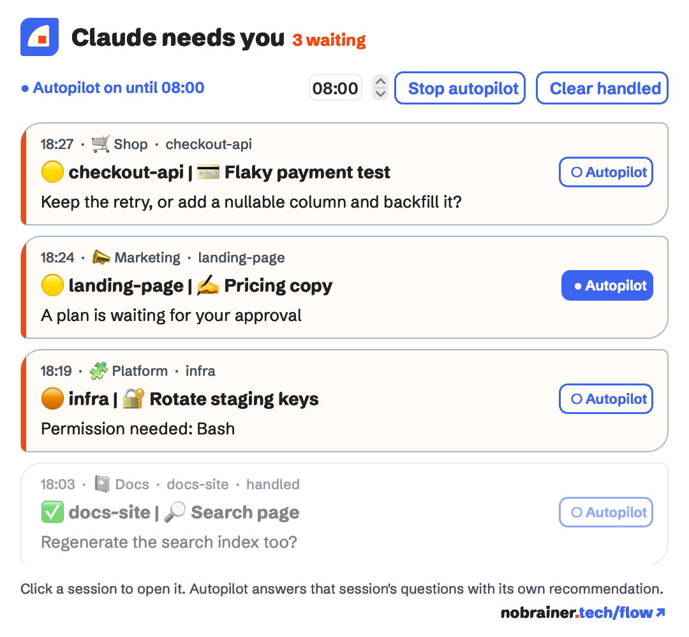

<p align="center">
  <a href="https://nobrainer.tech">
    
  </a>
</p>

<h1 align="center">Needs You</h1>

<p align="center">
  <strong>For Claude Code geeks with a sidebar full of sections, sessions and sub-sessions.<br>
  Every one that waits for you, in one window. One click opens it.<br>
  Autopilot clicks for you while you are away.</strong>
</p>

<p align="center">
  <a href="#install">Install</a> ·
  <a href="#what-autopilot-answers">What autopilot answers</a> ·
  <a href="https://github.com/nobrainer-tech/nobrainer-tech-flow">Get NoBrainer Tech Flow</a>
</p>

<p align="center">
  <a href="https://github.com/nobrainer-tech/claude-needs-you/actions/workflows/test.yml"></a>
  <a href="LICENSE"></a>
</p>

<p align="center">
  
</p>

**Who it is for.** You run Claude Code like a team: sidebar sections per area,
a coordinator session in each, sub-sessions it started, a dozen conversations
working at once. In that setup one of them is always waiting for you: a
question, a plan to approve, a permission prompt. You find out when you happen
to scroll past it, sometimes hours later. With one or two sessions you do not
need this; Claude Code's own notifications are enough.

**Needs You** puts all of them in one small window:

- **One list, newest on top.** Each row shows when the session asked, its
  sidebar section, its project, its title and the question. A newer question
  from the same session replaces the older one.
- **One click opens the session** in the Claude desktop app.
- **Handled ones grey out and drop to the bottom** as soon as you answer, so the
  top of the list is always what still waits. They disappear after a day, or
  when you click "Clear handled".
- **The window stays.** It opens by itself when a request arrives and none is
  open, on top but without taking the focus from what you are typing. After
  that it only updates in place. You close it when you want.
- **Autopilot, per session or for all of them.** Tick "Autopilot" on a session
  and it stops waiting for you: it takes its own recommended answer, its plan
  is approved and its permission prompts are granted. Or press "Autopilot
  until 08:00" before you leave. Every decision is logged. Merging, pushing,
  deploying, publishing, sending, deleting, paying and anything with
  credentials still wait for you. Autopilot answers from the next request on:
  a request that already waits when you tick it stays in the window, marked,
  until you open the session and answer it.

## Install

You need macOS, Claude Code, `jq` (recent macOS includes it; otherwise
`brew install jq`) and the Xcode Command Line Tools for the window
(`xcode-select --install`; you have them if `git` works).

In Claude Code:

```text
/plugin marketplace add nobrainer-tech/claude-needs-you
/plugin install needs-you@claude-needs-you
```

Sessions that were already open pick the plugin up after a restart. The first
request builds the window once (a few seconds); after that it opens at once. To
check the setup, ask any session: `test the needs-you window`.

Without the Swift compiler the plugin falls back to a `terminal-notifier` banner
(`brew install terminal-notifier`) or a dialog per request.

## Use it

By day there is nothing to do: the window comes when a session waits.

- Click a session to open it.
- Tick **Autopilot** on a session you trust to carry on alone.
- Before you leave, press **Autopilot until** (08:00 by default), or tell any
  session `autopilot until 8`.

In the morning ask any session `what did autopilot decide?`. An example report:

```text
2026-11-09 23:41  checkout-api | flaky payment test  Add a nullable column or keep the retry? -> Keep the retry (Recommended)
2026-11-10 02:17  docs-site | search page  Regenerate the search index too? -> Yes, regenerate
2026-11-10 03:05  checkout-api | flaky payment test  Commit the fix? -> left for the owner (commit)
```

The command behind it is [`bin/nb-autopilot`](bin/nb-autopilot): `on [HH:MM]`,
`off`, `session on|off ID`, `status`, `report` and `doctor`. Sessions have it on
their PATH. `needs-you-window` opens the window by hand.

## What autopilot answers

| A session | With autopilot on |
|---|---|
| asks a question with options (`AskUserQuestion`) | is told to take the option whose label ends with `(Recommended)`, or the first one, and continue |
| ends a turn with a question (Claude desktop app) | is told to act on its first suggested answer and finish the turn |
| ends a turn asking for a go-ahead to commit or open a pull request | is told not to take that step; the question is left for you |
| asks about merging, pushing, deploying, publishing, deleting, paying, logging in or granting a permission | is not answered, even when it recommends that step: the question waits for you, in the window |
| has a plan waiting for approval | the plan is approved |
| needs a permission | the permission is granted |
| had a command blocked | waits for you, in the window |
| any of the above naming a step only you may take | waits for you, in the window |

The instruction also names what a session must never decide alone: logins and
passwords, payments, merging, pushing or deploying, publishing or sending
anything to other people, deleting data, irreversible production changes and
granting permissions. The session skips that step, finishes the rest and leaves
the question in its final message.

Before you trust it with a night:

- Autopilot approves plans and grants permissions through the hook's own
  decision, the same as your click. It checks the request's text (the
  question, the plan, the command or tool and its input) for steps only you may
  take: merge, push, deploy, publish, release, send, email, post, delete,
  `rm`, force, pay, refund, login, password, credential, secret, token, sudo,
  commit, pull request, ssh, and a `curl` that sends data, in English and
  Polish. Those wait for you. It is a word list, so it errs on the side of
  waiting.
- The report shows the answer each session was told to take. What the session
  did next is in that session.
- It picks what the session itself recommended. It does not judge whether the
  recommendation is right.
- No record, no answer: if a decision cannot be written to the log, autopilot
  does not answer and the request goes to the window instead.
- Autopilot for all sessions ends at the time you set, at most 24 hours ahead.
  A ticked session stays on autopilot until you untick it.

## Settings

Put them in `~/.claude/needs-you/settings.json`. It is read on every request,
so a change reaches every open session at once:

```json
{
  "NEEDS_YOU_LANG": "pl",
  "NEEDS_YOU_IDLE_CMD": "say \"$1\""
}
```

The `env` block of `~/.claude/settings.json` works too and wins over the file,
but a session only sees it if it started after the change.

| Variable | What it does | Default |
|---|---|---|
| `NEEDS_YOU_LANG` | A built-in translation of every text: `pl` (Polish). [Add yours](texts/). | English |
| `NEEDS_YOU_IDLE_CMD` | A shell command to run when a request comes while you are away from the Mac, for example a message to your phone. It gets `NEEDS_YOU_MESSAGE`, `NEEDS_YOU_SESSION_TITLE`, `NEEDS_YOU_SESSION_ID`, and one line of text as `$1`. | none |
| `NEEDS_YOU_IDLE_MINUTES` | Minutes without keyboard or mouse input that count as away | `10` |
| `NEEDS_YOU_WINDOW` | `0` turns the window off: a banner or a dialog per request instead | `1` |

Any single text can also be set on its own (it wins over the translation):
`NEEDS_YOU_TITLE` (`Claude needs you`), `NEEDS_YOU_WAITING_COUNT` (`waiting`),
`NEEDS_YOU_HANDLED` (`handled`), `NEEDS_YOU_EMPTY`, `NEEDS_YOU_HINT`,
`NEEDS_YOU_CLEAR` (`Clear handled`), `NEEDS_YOU_ROW_AUTOPILOT` (`Autopilot`),
`NEEDS_YOU_ROW_ON_AUTOPILOT`, `NEEDS_YOU_ROW_AP_PENDING`,
`NEEDS_YOU_AP_START` (`Autopilot until`), `NEEDS_YOU_AP_STOP`,
`NEEDS_YOU_AP_ON`, `NEEDS_YOU_AP_OFF`, `NEEDS_YOU_PLAN`,
`NEEDS_YOU_PERMISSION`, `NEEDS_YOU_BLOCKED`, `NEEDS_YOU_WAITING`, and for the
fallback dialog `NEEDS_YOU_OPEN` and `NEEDS_YOU_LATER`.

## How it works

- One Bash script, [`hooks/needs-you.sh`](hooks/needs-you.sh), is wired in
  [`hooks/hooks.json`](hooks/hooks.json) to `PreToolUse` (`AskUserQuestion`,
  `ExitPlanMode` and the desktop app's end-of-turn question), `Notification`,
  `PermissionRequest` and `PermissionDenied`. It writes one JSON file per
  session to `~/.claude/needs-you/inbox/`. The same request from one session
  counts once per two minutes.
- `UserPromptSubmit`, `PostToolUse` and `SessionEnd` mark a session's entry
  handled: you wrote to it, its own tool call finished, or it ended. The end-of-turn tool and subagents do
  not count.
- The window is about 450 lines of Swift and AppKit in [`app/`](app), built once
  with `swiftc` into `~/Library/Caches/needs-you/bin/`. It reads the inbox every
  second, and a lock file keeps it to one window per user. No Electron, no
  daemon, no network calls. It uses the NoBrainer Sans typeface (SIL Open Font
  License, [`app/fonts/OFL.txt`](app/fonts/OFL.txt)).
- Autopilot is a `PreToolUse` "deny" whose reason is the instruction above.
  State is `~/.claude/needs-you/autopilot.json` and the log `decisions.jsonl`.
  The log only grows: delete it when you no longer need it.

Two skills come with the plugin: [`autopilot`](skills/autopilot/SKILL.md) tells
a session how to switch it and how to act when its question is refused;
[`needs-you`](skills/needs-you/SKILL.md) covers setup, testing and
troubleshooting.

## Limits

- macOS only.
- The click-to-open link works for sessions of the Claude desktop app. A
  session in a terminal is listed with its folder name and no link.
- It runs while your Mac is awake and Claude Code is open.
- Any session that can run shell commands can switch autopilot on. The skill
  tells sessions to do it only when you ask.
- Built and tested with Claude Code 2.1.321.

## Work that finishes: NoBrainer Tech Flow

Needs You decides who answers a question. It does not decide whether the work
is right. For that, use **[NoBrainer Tech Flow](https://github.com/nobrainer-tech/nobrainer-tech-flow)**,
a free, open-source workflow for AI coding agents:

- It sets the outcome and the evidence before the work starts.
- Its autopilot carries an approved plan through to the whole goal.
- At the end the agent hands over what was delivered, what was checked and what
  was not.

Together they cover a night run: Flow keeps the work on the plan, and Needs You
keeps it from stopping on a question you would have answered with "yes, the
recommended one".

## Install without the plugin system

Clone the repository and add the hook to `~/.claude/settings.json` with the
absolute path of your clone, for each event in [`hooks/hooks.json`](hooks/hooks.json):

```json
{ "type": "command", "command": "/path/to/claude-needs-you/hooks/needs-you.sh", "timeout": 5 }
```

Merge it with the hooks you already have. Then run
`/path/to/claude-needs-you/bin/nb-autopilot doctor`.

## Tests

```bash
bash tests/test.sh            # the inbox: 61 checks
bash tests/autopilot-test.sh  # autopilot: 77 checks
bash tests/window-test.sh     # builds the window and renders it to a PNG
```

The first two run the hook against stand-ins for the window, the notifier, the
dialog and `open`, in a temporary home folder. Nothing shows on screen.

---

Built by **[NoBrainer Tech](https://nobrainer.tech)**. From task to done.

**[Use the full NoBrainer Tech Flow workflow →](https://github.com/nobrainer-tech/nobrainer-tech-flow)**
